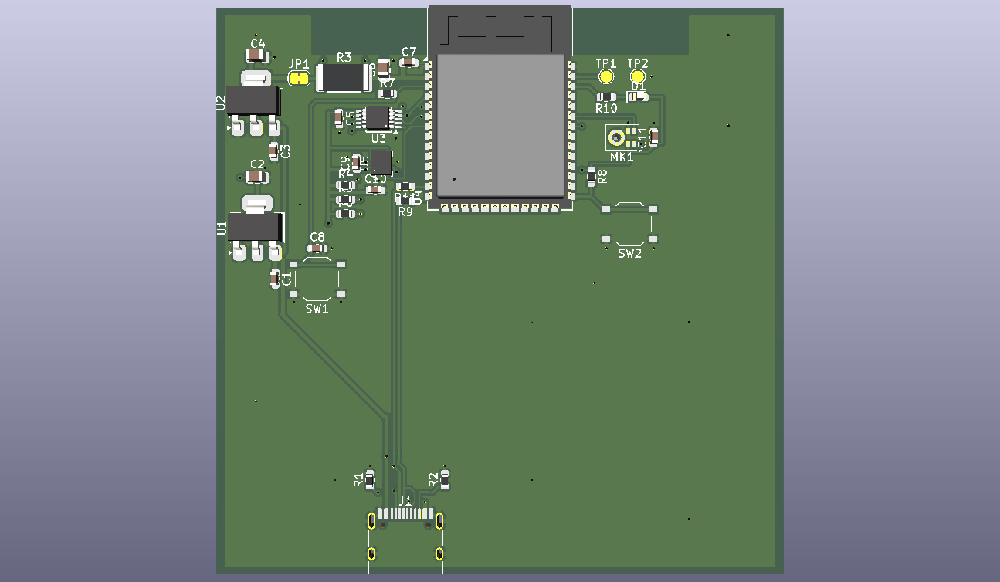
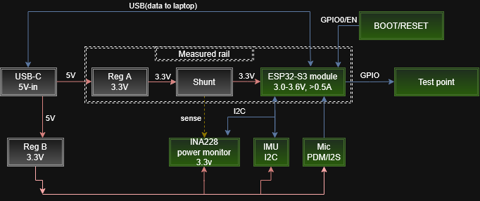
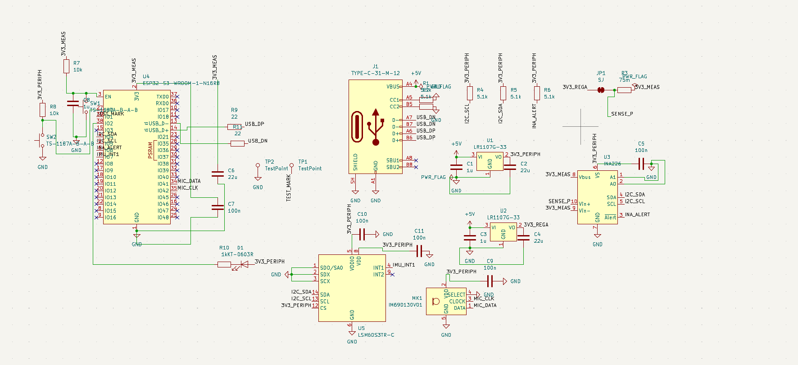
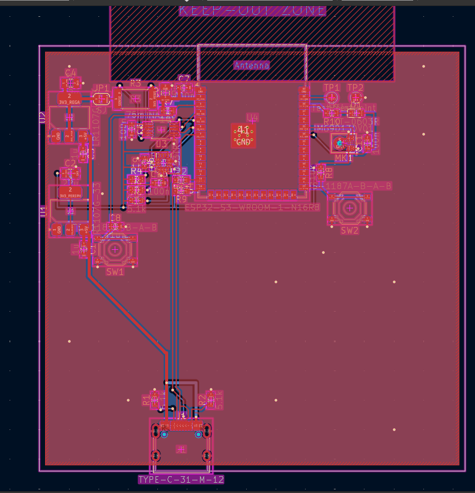

# TinyDyno

An ESP32-S3 board that measures the speed and energy efficiency of one neural network inference.

**What is it exactly?**
TinyDyno is a custom 72 by 72 mm, 2 layered PCB based on ESP32-S3.It is basically a test bench for machine learning on tiny devices (AKA edgeAI). It runs a neural network based on the data from sensors and measures every inference for time and energy. Time is how long the inference took and energy is how much ESP32-S3 has used during it.

To account for actual use cases it has an IMU(motion sensor) and a microphone which are for gesture recognition and keyword detector so the usual run look something like this:
1. Record the input from either sensors
2. Run the same model on the same input but with different libraries.(My kernels VS Espressif's ESP-DL VS TensorFlow Lite Micro)
3. Measure each run using the INA226 (power monitor) which reports current/voltage going into the ESP32-S3 which does the power over time math
4. Get the results and make conclusions

(A test pad (TP1) goes high during each inference, so the timing can be checked independently with an oscilloscope or logic analyzer.)

**The WHY behind it all**

Wanting to optimize the field I am currently curious about (AI) I brainstormed for a bit and came to the conclusion that you can't optimize something that you can't measure. After a bit of digging I found few issues it would solve on top of the qol it would provide for me:
1.Most benchmarks only report speed so a faster kernel that uses more power can still drain the battery sooner.
2.The USB power meters are quite slow. They update a few times per second, while one inference takes about 5–50 ms.

(Also it's not like you can find stuff like this easily to buy)

**how does it work?**

**Power: two separate 3.3V rails**

USB-C gives 5V and two separate 3.3V regulators split it into two rails:
1. **Measured rail (3V3_MEAS):** 5V goes through regulator U2, then solder jumper JP1, then the 75 mOhm shunt resistor R3 and then into the ESP32-S3. The ESP32 is the only thing on this rail.
2. **Peripheral rail (3V3_PERIPH):** 5V goes through regulator U1 to everything else (INA226, IMU, mic, LED, pull-ups).

So none of the sensor or LED current goes through the shunt and the measurement is only the ESP32.

**Measuring power**

Current going through the shunt makes a small voltage across it (V = I * R). For example at 100mA it's 0.1A * 0.075 Ohm = 7.5mV, which is tiny, so the INA226 (U3) does the job:
1. measures the voltage across the shunt to get the current
2. measures the 3.3V rail to get the voltage
3. multiplies them to get power
4. pulls its ALERT pin low when a new reading is ready so the ESP32 knows when to read it

The shunt is read through a separate pair of thin traces that go straight from the shunt's pads to the INA226 (Kelvin sensing), so the voltage drop on the thick power traces doesn't mess up the reading.

**From power to energy and time**

Energy = power * time, so during an inference the ESP32 reads the power about once a millisecond and keeps adding up power * time. Time comes from the ESP32's internal microsecond timer.

One measurement looks like this:
1. Load the recorded input
2. Set TP1 high, start the timer and the energy sum
3. Run the model
4. Set TP1 low, stop, and send time and energy to the PC over USB

**Known problem**

The ESP32 reads its own power monitor, so the reading itself costs a bit of energy too. The plan is to do the measuring on one core and the model on the other, and subtract the idle power.

**Schematic and PCB**

1. Schematic: [hardware/kicad/TinyDyno.kicad_sch](hardware/kicad/TinyDyno.kicad_sch)
2. PCB: [hardware/kicad/TinyDyno.kicad_pcb](hardware/kicad/TinyDyno.kicad_pcb)
3. Gerbers, assembly BOM and placement file: [hardware/kicad/production/](hardware/kicad/production/)

**PCB design notes**

1. 2 layers, 72 by 72mm, 1.6mm thick, made in KiCad
2. GND pour on both layers with stitching vias
3. No copper under the ESP32 antenna
4. Track widths: 0.5mm for power, 0.25mm default, 0.2mm on fine-pitch pins
5. Vias are 0.6mm with 0.3mm holes. The ESP32 module's thermal vias were 0.2mm, so I enlarged them to 0.3mm to fit JLCPCB's 2-layer minimum
6. JP1 is a solder jumper that's closed by default. Cutting it opens the measured rail, so I can put a multimeter or bench supply in there to calibrate the INA226

**Pin map**

| Signal | ESP32-S3 pin |
|---|---|
| I2C SDA / SCL (INA226 and IMU) | IO4 / IO5 |
| INA226 ALERT (new reading ready) | IO6 |
| IMU interrupt (INT1) | IO7 |
| Mic DATA / CLK | IO41 / IO42 |
| Timing marker (TP1) | IO1 |
| Status LED (on when the pin is low) | IO2 |
| Boot button | IO0 |
| USB D- / D+ | IO19 / IO20 |

I2C addresses: INA226 is 0x40, IMU is 0x6A.

**What it can measure (INA226 + 75 mOhm shunt)**

| Item | Value |
|---|---|
| Current range | +/- 1.09A |
| Current resolution | about 33uA |
| Voltage resolution | 1.25mV |
| Fastest conversion | 140us (averaging adjustable) |
| Voltage lost across the shunt | about 37.5mV at 0.5A |

**BOM (bill of materials)**

Every part on the board. Everything is from LCSC and soldered by JLCPCB. Quantities are per board (2 boards get assembled).

Chips and main parts:

| Ref | Qty | Part | What it does | Package | LCSC |
|---|---|---|---|---|---|
| U4 | 1 | ESP32-S3-WROOM-1-N16R8 | Main microcontroller (16MB flash, 8MB PSRAM). Runs the models and the measuring | Module | [C2913202](https://www.lcsc.com/product-detail/C2913202.html) |
| U3 | 1 | INA226AIDGSR | Power monitor, measures current through R3 and the rail voltage | TSSOP-10 | [C49851](https://www.lcsc.com/product-detail/C49851.html) |
| U5 | 1 | LSM6DS3TR-C | 6-axis IMU (accelerometer + gyro), input for gesture models | LGA-14 | [C967633](https://www.lcsc.com/product-detail/C967633.html) |
| MK1 | 1 | IM69D130V01 | Digital PDM microphone, input for keyword detection | LLGA-5 | [C536262](https://www.lcsc.com/product-detail/C536262.html) |
| U1, U2 | 2 | LR1107G-33 | 3.3V regulators. U1 is for the peripheral rail, U2 for the measured rail | SOT-223 | [C171499](https://www.lcsc.com/product-detail/C171499.html) |
| R3 | 1 | 75 mOhm, 1%, 2512 | Shunt resistor in the ESP32's supply | 2512 | [C76252](https://www.lcsc.com/product-detail/C76252.html) |
| J1 | 1 | TYPE-C-31-M-12 | USB-C connector, 5V and USB data | SMD | [C165948](https://www.lcsc.com/product-detail/C165948.html) |
| SW1, SW2 | 2 | TS-1187A-B-A-B | Buttons. SW1 = reset (EN), SW2 = boot (IO0) | SMD | [C318884](https://www.lcsc.com/product-detail/C318884.html) |
| D1 | 1 | KT-0603R red LED | Status LED | 0603 | [C2286](https://www.lcsc.com/product-detail/C2286.html) |

Resistors:

| Ref | Qty | Value | What it does | Package | LCSC |
|---|---|---|---|---|---|
| R1, R2 | 2 | 5.1k | USB-C CC pull-downs, tell the PC/charger to give 5V | 0603 | [C23186](https://www.lcsc.com/product-detail/C23186.html) |
| R4, R5 | 2 | 5.1k | I2C pull-ups on SCL and SDA | 0603 | [C23186](https://www.lcsc.com/product-detail/C23186.html) |
| R6 | 1 | 5.1k | Pull-up for the INA226 ALERT line | 0603 | [C23186](https://www.lcsc.com/product-detail/C23186.html) |
| R7 | 1 | 10k | ESP32 EN (enable) pull-up | 0603 | [C25804](https://www.lcsc.com/product-detail/C25804.html) |
| R8 | 1 | 10k | IO0 (boot pin) pull-up so it boots normally | 0603 | [C25804](https://www.lcsc.com/product-detail/C25804.html) |
| R9, R11 | 2 | 22 Ohm | Series resistors on USB D+ / D- | 0603 | [C23345](https://www.lcsc.com/product-detail/C23345.html) |
| R10 | 1 | 1k | Current limit for the LED | 0603 | [C21190](https://www.lcsc.com/product-detail/C21190.html) |

Capacitors:

| Ref | Qty | Value | What it does | Package | LCSC |
|---|---|---|---|---|---|
| C1, C3 | 2 | 1uF | Input caps of the two regulators (5V side) | 0603 | [C15849](https://www.lcsc.com/product-detail/C15849.html) |
| C8 | 1 | 1uF | Together with R7 delays EN so the ESP32 starts cleanly | 0603 | [C15849](https://www.lcsc.com/product-detail/C15849.html) |
| C2 | 1 | 22uF | Output cap of U1 (peripheral rail) | 0805 | [C45783](https://www.lcsc.com/product-detail/C45783.html) |
| C4 | 1 | 22uF | Output cap of U2 (before the shunt) | 0805 | [C45783](https://www.lcsc.com/product-detail/C45783.html) |
| C6 | 1 | 22uF | Bulk cap at the ESP32 (after the shunt), handles Wi-Fi current spikes | 0805 | [C45783](https://www.lcsc.com/product-detail/C45783.html) |
| C7 | 1 | 100nF | Decoupling at the ESP32 power pin | 0603 | [C14663](https://www.lcsc.com/product-detail/C14663.html) |
| C5, C9, C10, C11 | 4 | 100nF | Decoupling for the INA226, IMU and mic | 0603 | [C14663](https://www.lcsc.com/product-detail/C14663.html) |

Not actual parts (just copper on the PCB):

| Ref | What it is |
|---|---|
| TP1 | Test pad, timing marker (high during an inference) |
| TP2 | Test pad, GND for the probe clip |
| JP1 | Solder jumper in the measured rail (closed by default) |

In total that's 32 parts per board, 16 different ones. The full exported list is in [hardware/kicad/production/bom.csv](hardware/kicad/production/bom.csv), and the cost list synced from Half Life is in [BOM.csv](BOM.csv).

**Cost (JLCPCB: 5 PCBs, 2 of them assembled)**

| Item | Cost |
|---|---|
| PCB, 2-layer, 72 by 72mm (x5) | $4.00 |
| ESP32-S3-WROOM-1-N16R8 (x2) | $10.29 |
| IM69D130V01 microphone (x2) | $6.25 |
| LSM6DS3TR-C IMU (x2) | $3.04 |
| INA226AIDGSR (x2) | $1.52 |
| LR1107G-33 regulators | $0.86 |
| 75 mOhm shunt resistors | $0.58 |
| USB-C connectors (x2) | $0.37 |
| Resistors, capacitors, LED and buttons | $2.42 |
| Standard assembly for 2 boards (setup, stencil, part loading, placement) | $66.86 |
| Shipping to Georgia (UPS), after a $10 coupon | $29.82 |
| **Total** | **$126.01** |

**Fabrication notes**

1. Ordered from JLCPCB with Standard assembly, top side only. JLC adds 5mm edge rails on two sides, which you snap off along the V-cut.
2. U3 change: I planned to use the INA228 but it was out of stock at JLC, so I swapped it for the INA226. Same footprint and pin order, so the layout didn't change. The INA226 doesn't have a built-in energy counter, so the energy gets added up in firmware instead.
3. MK1 rotation: positions.csv says 180 degrees, but I rotated the mic by hand in JLC's placement preview. If you re-order, check it again.

